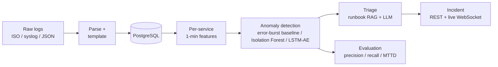

# Sentinel Triage

**Turns a flood of application logs into a short, evidence-backed incident report: what broke, where, why, and which runbook to follow.**

[](https://github.com/Abhishek2114/sentinel-triage/actions/workflows/ci.yml)


> **The problem.** During an outage, on-call engineers scroll through thousands of log lines a
> minute to work out whether something is really wrong, which service it is, and what caused it.
> Threshold alerts are noisy and miss failures that change the *kind* of logs rather than the volume.
>
> **The approach.** Reduce every log line to a template, build per-service minute-by-minute
> features, detect anomalous windows (a statistical baseline and ML models, compared head to head),
> then have an LLM explain each anomaly using the actual log lines and the team's runbooks. Every
> detector is scored against labelled faults, so quality is measured, not assumed.

<!-- TODO (Phase 7): add a dashboard screenshot or GIF here. It's the first thing a reviewer looks at. -->

---

## How it works



1. **Parse.** Three log formats become one schema with UTC timestamps and canonical levels.
2. **Template.** `"GC pause 120ms"` and `"GC pause 8000ms"` → `"GC pause <NUM>"`. This turns free text
   into countable event types: a 6-hour synthetic log collapses from ~7,000 lines to 45 templates.
3. **Featurize.** Per service and per minute: event count, error count/rate, distinct templates, and
   *new* templates never seen before (the signature of a bad deploy).
4. **Detect.** Pluggable detectors behind one interface (`fit / score / detect`, higher score = more
   anomalous), fitted per service: a statistical **error-burst** baseline, **Isolation Forest**, and
   (next) an **LSTM autoencoder**. Consecutive flagged minutes merge into one anomaly, and re-runs
   update rows instead of duplicating them. Runs on demand (`POST /detect`) or every 5 minutes (Celery beat).
5. **Triage.** Rank the anomaly's log patterns by how much more often they appear than in the hour
   before, use the top ones to retrieve the right runbook (pgvector), then have an LLM write a
   structured report. Every claim is checked against what it was shown, and with no LLM a rule-based
   report is written instead.
6. **Group.** A fault that flaps (flagged, quiet for a few minutes, flagged again) joins the open
   incident on that service instead of opening another one, so one fault is one page and one LLM call.
7. **Serve.** Incidents are exposed through a REST API and pushed live to a React dashboard: whoever
   changes an incident publishes to Redis, and every API process relays it to its WebSocket clients.
8. **Evaluate.** The log generator injects four labelled fault types (CPU spike, DB connection
   failure, bad deploy, memory leak), so each detector gets precision, recall and mean time to detect.

👉 **Design decisions, trade-offs and the scaling path are in [docs/DESIGN.md](docs/DESIGN.md).**

## Status

| Phase | Deliverable | Status |
|-------|-------------|--------|
| 0. Skeleton | FastAPI, Docker Compose, CI (lint, strict typing, tests, migrations) | ✅ |
| 1. Ingest | Parser, templating, Postgres storage, labelled synthetic log generator | ✅ |
| 2. Detect | Per-service features, error-burst baseline + Isolation Forest, `POST /detect`, scheduled Celery task, idempotent `anomalies` upserts | ✅ |
| 3. Eval | Reproducible `run_eval.py`: precision, recall, F1, MTTD, false alarms/day, per-fault-type recall | ✅ |
| 4. Triage | Lift-ranked evidence, pgvector runbook retrieval, grounded LLM report (optional), Celery + API | ✅ |
| 5. Live UI | React dashboard, Redis pub/sub → WebSocket alerts, anomalies grouped into incidents | ✅ |
| 6. Second model | LSTM autoencoder vs. Isolation Forest comparison | 🔲 |
| 7. Deploy | One-server production stack (Compose + Caddy HTTPS, public demo mode), VPS guide; hosted demo and screenshots to come | 🟡 |

## Results

Measured on **50 held-out synthetic runs** (6 hours each, 300 hours in total, **200 labelled faults**).
These seeds were never used to tune any detector setting.

| Detector | Precision | Recall | F1 | MTTD | False alarms / day |
|---|---|---|---|---|---|
| Error-burst baseline (`error_burst`) | **0.97** | 0.85 | **0.91** | 4.1 min | **0.5** |
| Isolation Forest (`iforest`) | 0.38 | 0.86 | 0.52 | 3.4 min | 33.7 |
| LSTM autoencoder | Phase 6 | | | | |

| Recall by fault type | `error_burst` | `iforest` |
|---|---|---|
| Bad deploy | 46/49 | 45/49 |
| CPU spike | 37/43 | 35/43 |
| DB connection failure | 50/51 | 51/51 |
| Memory leak | 38/57 | 42/57 |

**What this shows**
- **The simple baseline wins.** Both detectors catch about 85% of faults, but Isolation Forest also
  raises ~34 false alarms a day against error-burst's 0.5. At this log volume (~4 lines per service
  per minute) one stray error looks unusual to a generic outlier model. Paging someone 34 times a day
  is not an option, so any ML detector now has to beat `error_burst`, not just exist.
  ([DESIGN.md §4.9](docs/DESIGN.md))
- **Memory leaks are the weak spot** (two-thirds caught). A leak builds up slowly rather than producing
  a burst of errors, which is the case the Phase 6 sequence model is meant to cover.
- **MTTD is detector latency**: when the first alert could fire, measured from the fault start. The
  5-minute Celery schedule adds up to 5 minutes on top in production.

**Triage picks the right runbook** for the faults the error-burst detector catches (the only
detector whose anomalies are triaged by default):

| Fault type | Right runbook ranked first |
|---|---|
| Bad deploy | 45/46 |
| CPU spike | 37/37 |
| DB connection failure | 50/50 |
| Memory leak | 38/38 |
| **All** | **99%** (170/171; 137/138 on seeds never looked at during development) |

This checks the deterministic part of triage (which log lines, which runbook) with the offline
embedder, so it reproduces without downloading a model. The LLM's prose has no labelled ground truth,
which is why its output is structured and checked instead ([DESIGN.md §4.8](docs/DESIGN.md)).

**One fault, one incident.** Grouping anomalies that are within 15 minutes on the same service:

| | Incidents | Per caught fault | Duplicate incidents | Two faults merged into one |
|---|---|---|---|---|
| No grouping | 197 | 1.12 | 20 | 0 |
| 15-minute grouping | 176 | **1.00** | **0** | **0** |

**How it's measured.** A fault counts as detected if an anomaly on the *same service* overlaps its
window. An anomaly that overlaps no fault is a false alarm, including one on the wrong service.
Counts are pooled across runs before computing the ratios. The detection and triage code is exactly
what the API runs (`detect_events`, `build_evidence`, the same retrieval ranking).

Reproduce it (about 1 minute; the output matches
[`eval/results/heldout.json`](eval/results/heldout.json) byte for byte):

```bash
python scripts/run_eval.py
```

## Quick start

```bash
# 1. Configure (defaults work for local development)
cp .env.example .env

# 2. Start Postgres and Redis
docker compose up -d postgres redis

# 3. Install
python -m venv .venv && source .venv/bin/activate
pip install -e ".[dev]"

# 4. Generate 6 hours of logs with 4 labelled faults
python scripts/generate_logs.py

# 5. Run the API (http://localhost:8000/docs for interactive docs)
uvicorn app.main:app --reload

# 6. Ingest the synthetic logs (paths must be inside data/)
curl -X POST http://localhost:8000/api/v1/ingest \
  -H "Content-Type: application/json" \
  -d '{"file_path": "data/synthetic/events.log"}'

# 7. Query events
curl "http://localhost:8000/api/v1/events?service=api-gateway&level=ERROR"

# 8. Detect anomalies, then compare them with data/synthetic/labels.jsonl
curl -X POST http://localhost:8000/api/v1/detect -H "Content-Type: application/json" -d '{}'
curl "http://localhost:8000/api/v1/anomalies?detector=error_burst"

# 9. Index the runbooks, then turn an anomaly into an incident
#    (no LLM configured → rule-based report; set OPENAI_API_KEY or LLM_BASE_URL in .env for one)
curl -X POST http://localhost:8000/api/v1/runbooks/index
curl -X POST http://localhost:8000/api/v1/anomalies/1/triage

# 10. Score every detector, and triage's runbook choice, on 50 held-out runs (no database needed)
python scripts/run_eval.py
```

In Docker Compose this is automatic: the worker indexes runbooks when it starts, and the scheduled
detection queues triage for every new error-burst anomaly.

An incident (no LLM configured; trimmed):

```json
{
  "summary": "error_burst flagged payment-service between 02:28 and 02:30 UTC: 6 errors in 30 events. Most unusual pattern: \"Worker thread pool exhausted, <NUM> requests queued\" (2x, vs 0x in the previous hour). 7 log pattern(s) did not appear at all in the previous hour.",
  "root_cause": "The log patterns best match the CPU Spike Runbook (cpu_spike.md). Not confirmed by an LLM.",
  "confidence": "low",
  "runbook": "cpu_spike.md",
  "next_steps": [
    "Immediate: Scale horizontally with HPA or add spot instances",
    "Short-term: Identify hot code path and add caching or circuit breaking",
    "Long-term: Fix algorithmic complexity, add load shedding"
  ],
  "evidence": [
    {"template": "Worker thread pool exhausted, <NUM> requests queued", "count": 2, "baseline_count": 0, "lift": 42.9},
    {"template": "CPU usage at <NUM>% – throttling new requests", "count": 2, "baseline_count": 0, "lift": 42.9}
  ],
  "triage_method": "fallback"
}
```

Everything in containers (API runs migrations on start, the worker indexes runbooks), with the
dashboard at http://localhost:5173:

```bash
docker compose up --build
```

Or run the dashboard against a local API (`uvicorn` from step 5):

```bash
cd dashboard && npm install && npm run dev   # http://localhost:5173, proxies /api to :8000
```

The dashboard shows a timeline of anomalies and incidents per service, the incident list (open /
resolved), and each incident's summary, next steps, ranked evidence and log lines. New and grouped
incidents arrive over the WebSocket without a reload; on reconnect it refetches, so nothing is missed.

## Deploy

One small VPS runs the whole stack. Caddy terminates HTTPS and gets its own certificate; the API
serves the built dashboard, and Postgres, Redis and the workers stay off the internet. With
`DEMO_MODE=true` anyone can browse and press **Run demo**, while every write needs an API key.

```bash
cp deploy/.env.example deploy/.env   # domain, secrets, demo mode, optional LLM key
docker compose -f deploy/docker-compose.prod.yml up -d --build
```

[docs/DEPLOY.md](docs/DEPLOY.md) walks through it step by step: server, DNS, firewall, secrets,
checks, updates and backups.

## API (v1)

| Method | Path | Purpose |
|--------|------|---------|
| `GET` | `/api/v1/health` | Liveness check, including database connectivity |
| `POST` | `/api/v1/ingest` | Ingest raw `lines` or a `file_path` under `data/` |
| `GET` | `/api/v1/events` | Query logs (filter by service, level, time range) |
| `POST` | `/api/v1/detect` | Run detection now (optional `service`, `since`, `until`, `detectors`) |
| `GET` | `/api/v1/anomalies` | List detected anomalies (filter by detector, service) |
| `POST` | `/api/v1/anomalies/{id}/triage` | Open a new incident (201), or join an open one / return the existing one (200) |
| `POST` | `/api/v1/runbooks/index` | Re-embed the runbooks into pgvector |
| `GET` | `/api/v1/incidents` | List incidents, most recently active first (filter by status, service) |
| `GET` | `/api/v1/incidents/{id}` | Incident detail with grouped anomalies and log lines |
| `PATCH` | `/api/v1/incidents/{id}` | Resolve or reopen (`{"status": "resolved"}`) |
| `WS` | `/api/v1/ws/alerts` | Live `incident.created` / `incident.updated` events |

## Tech stack

**API:** FastAPI, Pydantic v2, SQLAlchemy 2 (async), Alembic · **Data:** PostgreSQL + pgvector,
Redis (pub/sub) · **Async work:** Celery · **UI:** React 18, TypeScript, Vite, Vitest · **ML:** scikit-learn, PyTorch (LSTM-AE), sentence-transformers ·
**Quality:** pytest, ruff, mypy `--strict`, GitHub Actions · **Ops:** Docker Compose, structlog

## Project layout

```
app/
  api/        REST + WebSocket routes
  ingest/     parser, templating, file reader
  detect/     features, detectors (error-burst, Isolation Forest, LSTM-AE), pipeline
  eval/       match anomalies to labelled faults, precision / recall / MTTD
  triage/     evidence ranking (lift vs. the previous hour), grouping, anomaly → incident
  rag/        runbook sections, embeddings, pgvector retrieval, LLM report + fallback
  workers/    Celery app and tasks
  models/     SQLAlchemy ORM models
  realtime.py Redis pub/sub publisher and relay to WebSocket clients
dashboard/    React + TypeScript dashboard (Vite)
scripts/      synthetic log generator, run_eval.py
eval/results  committed evaluation report (heldout.json)
data/runbooks Markdown runbooks used for retrieval
migrations/   Alembic schema migrations
deploy/       production Compose file, Caddyfile, env template
docs/         design document, VPS deploy guide
```

## Development

```bash
pytest --cov=app                          # tests (DB tests skip without Postgres)
ruff check app/ tests/ scripts/ migrations/   # lint
mypy app/ --ignore-missing-imports        # strict type check
alembic upgrade head                      # apply migrations
cd dashboard && npm run typecheck && npm test   # dashboard
```

## License

MIT
