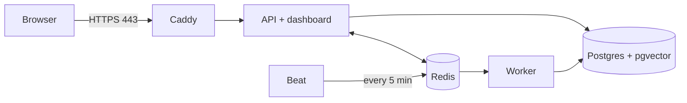

# Deploying to a VPS

One small Linux server runs the whole stack with Docker Compose. Caddy is the
only thing exposed to the internet: it gets an HTTPS certificate on its own
and forwards everything to the API, which also serves the dashboard.



Postgres, Redis, the Celery worker and beat have no published ports.

## What you need

- **A server** with 2 vCPU and 2 GB RAM or more, running Ubuntu 24.04. For example
  Hetzner CX22 (about €4/month), a DigitalOcean droplet or AWS Lightsail. Oracle
  Cloud has one for free; see [the next section](#free-server-oracle-cloud-always-free).
- **A domain or subdomain** you can add a DNS record to, such as
  `sentinel.yourname.dev`. Without one, `sslip.io` gives you a name for free (see
  the Oracle section, step 5).
- An LLM API key is **optional**. Without one, triage writes rule-based reports.

## Free server: Oracle Cloud Always Free

Oracle's free tier includes an ARM server that stays on all the time, unlike
free app hosts, which sleep when nobody visits. It's plenty for this stack. In
2026 the free allowance is up to 2 ARM cores and 12 GB of RAM in total; check
Oracle's current limits when you sign up. These steps replace steps 1 to 3
below. Every image the stack uses is published for ARM, so nothing changes in
the code.

1. **Sign up** at [oracle.com/cloud/free](https://www.oracle.com/cloud/free/).
   Choose the **home region** carefully: free ARM servers can only be created
   there, and busy regions sometimes run out of them. Oracle asks for a card to
   verify you; Always Free resources aren't charged.
2. **Create the server.** Go to **Compute → Instances → Create instance**.
   - **Image:** Canonical Ubuntu 24.04.
   - **Shape:** Ampere, `VM.Standard.A1.Flex`, with 2 OCPUs and 12 GB of
     memory. If Oracle reports "out of capacity", try another availability
     domain, or 1 OCPU and 6 GB.
   - **Networking:** keep the new virtual cloud network with a public subnet,
     and keep "Assign a public IPv4 address" on.
   - **SSH keys:** upload your public key (for example `~/.ssh/id_ed25519.pub`),
     or let Oracle generate a pair and download the private key.

   Note the **public IP address** once the server is running.
3. **Open ports 80 and 443 in Oracle's network firewall.** Open the server's
   subnet, then its **security list** (usually "Default Security List"), and
   add an ingress rule: source `0.0.0.0/0`, protocol TCP, destination ports
   `80,443`.
4. **Open them on the server too.** Oracle's Ubuntu images come with
   `iptables` rules that block everything except SSH, and `ufw` doesn't apply
   on top of them, so skip the `ufw` line in step 3. Log in as `ubuntu` and
   become root, so the rest of this guide's commands work as written:

   ```bash
   ssh ubuntu@<server-ip>
   sudo -i
   iptables -I INPUT 5 -m state --state NEW -p tcp --dport 80 -j ACCEPT
   iptables -I INPUT 5 -m state --state NEW -p tcp --dport 443 -j ACCEPT
   netfilter-persistent save
   ```

   Then install Docker as in step 3. With 12 GB of RAM you don't need swap.
5. **A name for the server.** With a domain, point it at the IP as in step 2.
   Without one, use `<ip-with-dashes>.sslip.io`. For example, `129.146.12.34`
   becomes `129-146-12-34.sslip.io`. It already resolves to your IP, and Caddy
   can get a certificate for it. Use that as `DOMAIN` in step 4.
6. **Stop Oracle reclaiming it.** Oracle may take back an Always Free server
   that stays idle for 7 days (CPU, network and memory use all under 20%). A
   demo is idle most of the time. Upgrading the account to **Pay As You Go**
   stops this. Always Free resources stay free, but anything else you create
   is billed.

Then continue from step 4.

## 1. Create the server

Create it in your provider's console with your SSH key, not a password.
Then log in:

```bash
ssh root@<server-ip>
```

## 2. Point the domain at it

At your DNS provider, add an **A record**: `sentinel` (or `@`) → `<server-ip>`.
Wait until it resolves. This command should print the server's IP:

```bash
dig +short sentinel.yourname.dev
```

Caddy can only get a certificate after this works.

## 3. Prepare the server

On the server:

```bash
apt-get update && apt-get upgrade -y
curl -fsSL https://get.docker.com | sh
```

Open only SSH and web traffic:

```bash
ufw allow OpenSSH && ufw allow 80/tcp && ufw allow 443/tcp && ufw allow 443/udp && ufw --force enable
```

Docker publishes ports past `ufw`'s rules. That's why the production Compose
file publishes nothing except Caddy's 80 and 443.

On a 2 GB server, add swap so image builds don't run out of memory:

```bash
fallocate -l 2G /swapfile && chmod 600 /swapfile && mkswap /swapfile && swapon /swapfile && echo '/swapfile none swap sw 0 0' >> /etc/fstab
```

## 4. Get the code and configure it

```bash
git clone https://github.com/Abhishek2114/sentinel-triage.git /opt/sentinel
cd /opt/sentinel
cp deploy/.env.example deploy/.env
```

Generate two secrets, one for Postgres and one for the API key:

```bash
openssl rand -hex 32
```

Edit `deploy/.env` (for example with `nano deploy/.env`):

| Setting | Value |
|---|---|
| `DOMAIN` | your domain, e.g. `sentinel.yourname.dev` |
| `ACME_EMAIL` | your email, for certificate expiry warnings |
| `POSTGRES_PASSWORD` | the first secret |
| `API_KEYS` | `["<the second secret>"]`, keeping the brackets and quotes |
| `DEMO_MODE` | `true` for a public demo |
| LLM settings | optional; uncomment one provider and add its key |

Keep the API key: you need it for anything that writes data. Then lock the
file down:

```bash
chmod 600 deploy/.env
```

## 5. Start it

```bash
docker compose -f deploy/docker-compose.prod.yml up -d --build
```

The first build takes a few minutes. Check that everything is up and healthy:

```bash
docker compose -f deploy/docker-compose.prod.yml ps
```

Watch Caddy get the certificate:

```bash
docker compose -f deploy/docker-compose.prod.yml logs -f caddy
```

Open `https://<your domain>`. The dashboard loads, the status reads **Live**,
and in demo mode **Run demo** works. Within about a minute a new incident
appears without reloading.

## 6. Check it from outside

The health endpoint should return `"db":"connected"`:

```bash
curl https://<your domain>/api/v1/health
```

A write without a key must be refused with `401`:

```bash
curl -i -X POST https://<your domain>/api/v1/detect -H 'Content-Type: application/json' -d '{}'
```

The same write with your key must work:

```bash
curl -X POST https://<your domain>/api/v1/detect -H "Authorization: Bearer <your API key>" -H 'Content-Type: application/json' -d '{}'
```

## Sending real logs

Run the shipping agent on any machine whose logs you want triaged. It sends
log lines to `/api/v1/ingest` with your API key in a header. The dashboard's
onboarding page shows the commands for your domain.

## Everyday operations

All commands are run from `/opt/sentinel`.

| Task | Command |
|---|---|
| Update to the latest code | `git pull && docker compose -f deploy/docker-compose.prod.yml up -d --build` |
| Follow the API's logs | `docker compose -f deploy/docker-compose.prod.yml logs -f api` |
| Restart everything | `docker compose -f deploy/docker-compose.prod.yml restart` |
| Stop (data is kept) | `docker compose -f deploy/docker-compose.prod.yml down` |
| Clear out old images | `docker image prune -f` |

Database migrations run automatically every time the API starts.

### Backups

Postgres data lives in the `sentinel_pgdata` volume. This dumps it to a
compressed file:

```bash
docker compose -f deploy/docker-compose.prod.yml exec -T postgres pg_dump -U sentinel sentinel | gzip > /root/sentinel-$(date +%F).sql.gz
```

To run it every night, put the same line in `crontab -e` with a schedule such
as `0 3 * * *`, and copy the files off the server now and then.

## Sizing

| Server RAM | Settings in `deploy/.env` |
|---|---|
| 2 GB | the defaults: `EMBEDDING_MODEL=hashing`, `WEB_CONCURRENCY=2`, `CELERY_CONCURRENCY=2` |
| 4 GB or more | you can use `EMBEDDING_MODEL=all-MiniLM-L6-v2`; the model is downloaded once into the `models` volume |

Runbook retrieval uses BM25 by default. On the retrieval evaluation it chose
the right runbook equally often with either embedder, so `hashing` costs
nothing in accuracy there.

## Security notes

- **No public writes.** In production the API won't start without
  `API_KEYS`. Anything that writes or costs money needs a key. Demo mode only
  makes reads public, plus the rate-limited demo button, which writes nothing
  but synthetic `demo-` services.
- **LLM spend is capped** per day across all processes. When the cap is hit,
  triage falls back to rule-based reports.
- **Keys never go in URLs.** They're sent only in headers, and the API refuses
  requests that put credentials in a query string.
- **Strict browser policies.** Every response carries a strict
  Content-Security-Policy, and Caddy adds HSTS.
- **Nothing internal is exposed.** Postgres and Redis are only reachable
  inside the Compose network.

## Trying the production stack on your own machine

With Docker installed, you can run the same stack against Caddy's local test
certificate authority. Set these in `deploy/.env`:

- `DOMAIN=localhost`
- `ACME_EMAIL` to any address
- secrets as above

Then start it:

```bash
docker compose -f deploy/docker-compose.prod.yml up -d --build
```

Open `https://localhost`. Your browser will warn about the certificate, which
is expected for Caddy's test authority.
