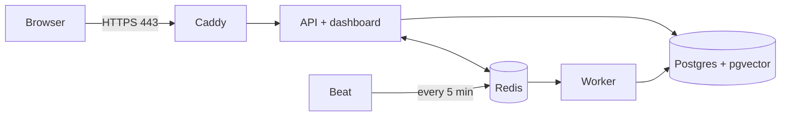

# Deploying to a VPS

One small Linux server runs the whole stack with Docker Compose. Caddy is the
only thing exposed to the internet: it gets an HTTPS certificate on its own
and forwards everything to the API, which also serves the dashboard.



Postgres, Redis, the Celery worker and beat have no published ports.

## What you need

- **A server** with 2 vCPU and 2 GB RAM or more, running Ubuntu 24.04. For example
  Hetzner CX22 (about €4/month), a DigitalOcean droplet or AWS Lightsail.
- **A domain or subdomain** you can add a DNS record to, such as
  `sentinel.yourname.dev`.
- An LLM API key is **optional**. Without one, triage writes rule-based reports.

## 1. Create the server

Create it in your provider's console with your SSH key, not a password.
Then log in:

```bash
ssh root@<server-ip>
```

## 2. Point the domain at it

At your DNS provider, add an **A record**: `sentinel` (or `@`) → `<server-ip>`.
Wait until it resolves. This command should print the server's IP:

```bash
dig +short sentinel.yourname.dev
```

Caddy can only get a certificate after this works.

## 3. Prepare the server

On the server:

```bash
apt-get update && apt-get upgrade -y
curl -fsSL https://get.docker.com | sh
```

Open only SSH and web traffic:

```bash
ufw allow OpenSSH && ufw allow 80/tcp && ufw allow 443/tcp && ufw allow 443/udp && ufw --force enable
```

Docker publishes ports past `ufw`'s rules. That's why the production Compose
file publishes nothing except Caddy's 80 and 443.

On a 2 GB server, add swap so image builds don't run out of memory:

```bash
fallocate -l 2G /swapfile && chmod 600 /swapfile && mkswap /swapfile && swapon /swapfile && echo '/swapfile none swap sw 0 0' >> /etc/fstab
```

## 4. Get the code and configure it

```bash
git clone https://github.com/Abhishek2114/sentinel-triage.git /opt/sentinel
cd /opt/sentinel
cp deploy/.env.example deploy/.env
```

Generate two secrets, one for Postgres and one for the API key:

```bash
openssl rand -hex 32
```

Edit `deploy/.env` (for example with `nano deploy/.env`):

| Setting | Value |
|---|---|
| `DOMAIN` | your domain, e.g. `sentinel.yourname.dev` |
| `ACME_EMAIL` | your email, for certificate expiry warnings |
| `POSTGRES_PASSWORD` | the first secret |
| `API_KEYS` | `["<the second secret>"]`, keeping the brackets and quotes |
| `DEMO_MODE` | `true` for a public demo |
| LLM settings | optional; uncomment one provider and add its key |

Keep the API key: you need it for anything that writes data. Then lock the
file down:

```bash
chmod 600 deploy/.env
```

## 5. Start it

```bash
docker compose -f deploy/docker-compose.prod.yml up -d --build
```

The first build takes a few minutes. Check that everything is up and healthy:

```bash
docker compose -f deploy/docker-compose.prod.yml ps
```

Watch Caddy get the certificate:

```bash
docker compose -f deploy/docker-compose.prod.yml logs -f caddy
```

Open `https://<your domain>`. The dashboard loads, the status reads **Live**,
and in demo mode **Run demo** works. Within about a minute a new incident
appears without reloading.

## 6. Check it from outside

The health endpoint should return `"db":"connected"`:

```bash
curl https://<your domain>/api/v1/health
```

A write without a key must be refused with `401`:

```bash
curl -i -X POST https://<your domain>/api/v1/detect -H 'Content-Type: application/json' -d '{}'
```

The same write with your key must work:

```bash
curl -X POST https://<your domain>/api/v1/detect -H "Authorization: Bearer <your API key>" -H 'Content-Type: application/json' -d '{}'
```

## Sending real logs

Run the shipping agent on any machine whose logs you want triaged. It sends
log lines to `/api/v1/ingest` with your API key in a header. The dashboard's
onboarding page shows the commands for your domain.

## Everyday operations

All commands are run from `/opt/sentinel`.

| Task | Command |
|---|---|
| Update to the latest code | `git pull && docker compose -f deploy/docker-compose.prod.yml up -d --build` |
| Follow the API's logs | `docker compose -f deploy/docker-compose.prod.yml logs -f api` |
| Restart everything | `docker compose -f deploy/docker-compose.prod.yml restart` |
| Stop (data is kept) | `docker compose -f deploy/docker-compose.prod.yml down` |
| Clear out old images | `docker image prune -f` |

Database migrations run automatically every time the API starts.

### Backups

Postgres data lives in the `sentinel_pgdata` volume. This dumps it to a
compressed file:

```bash
docker compose -f deploy/docker-compose.prod.yml exec -T postgres pg_dump -U sentinel sentinel | gzip > /root/sentinel-$(date +%F).sql.gz
```

To run it every night, put the same line in `crontab -e` with a schedule such
as `0 3 * * *`, and copy the files off the server now and then.

## Sizing

| Server RAM | Settings in `deploy/.env` |
|---|---|
| 2 GB | the defaults: `EMBEDDING_MODEL=hashing`, `WEB_CONCURRENCY=2`, `CELERY_CONCURRENCY=2` |
| 4 GB or more | you can use `EMBEDDING_MODEL=all-MiniLM-L6-v2`; the model is downloaded once into the `models` volume |

Runbook retrieval uses BM25 by default. On the retrieval evaluation it chose
the right runbook equally often with either embedder, so `hashing` costs
nothing in accuracy there.

## Security notes

- **No public writes.** In production the API won't start without
  `API_KEYS`. Anything that writes or costs money needs a key. Demo mode only
  makes reads public, plus the rate-limited demo button, which writes nothing
  but synthetic `demo-` services.
- **LLM spend is capped** per day across all processes. When the cap is hit,
  triage falls back to rule-based reports.
- **Keys never go in URLs.** They're sent only in headers, and the API refuses
  requests that put credentials in a query string.
- **Strict browser policies.** Every response carries a strict
  Content-Security-Policy, and Caddy adds HSTS.
- **Nothing internal is exposed.** Postgres and Redis are only reachable
  inside the Compose network.

## Trying the production stack on your own machine

With Docker installed, you can run the same stack against Caddy's local test
certificate authority. Set these in `deploy/.env`:

- `DOMAIN=localhost`
- `ACME_EMAIL` to any address
- secrets as above

Then start it:

```bash
docker compose -f deploy/docker-compose.prod.yml up -d --build
```

Open `https://localhost`. Your browser will warn about the certificate, which
is expected for Caddy's test authority.
