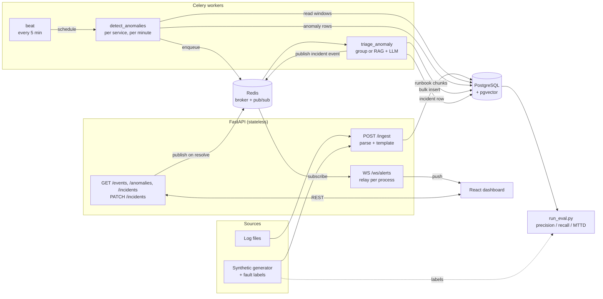
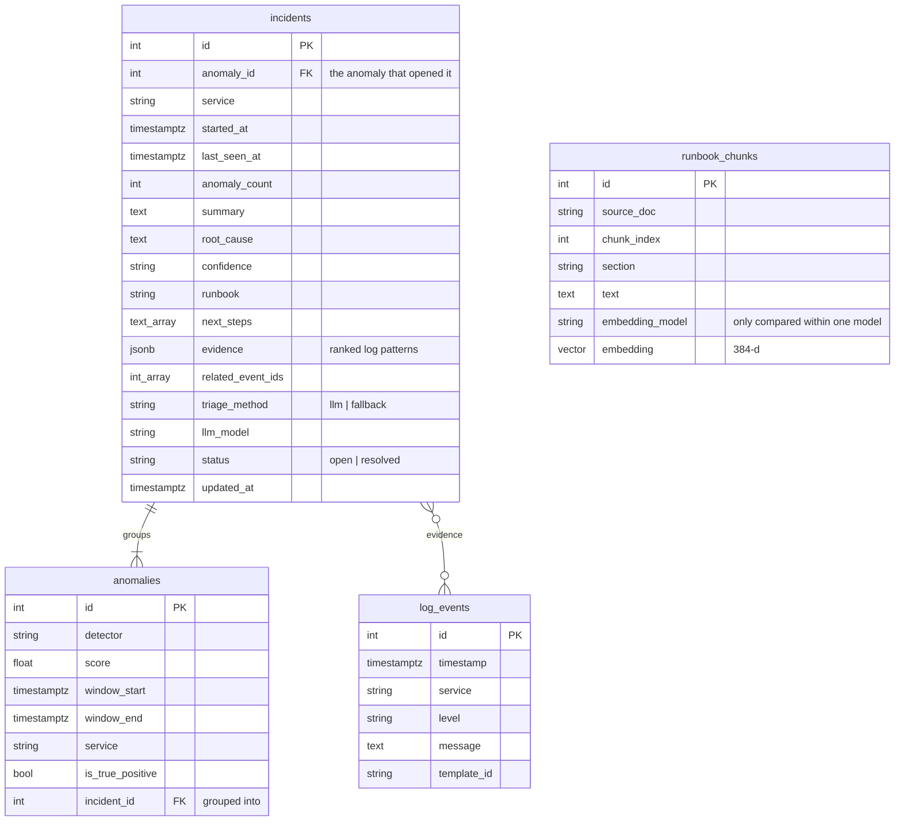

# Sentinel Triage – Design

This document explains *why* Sentinel Triage is built the way it is: the problem,
the architecture, the decisions and their trade-offs, and what changes at scale.
The [README](../README.md) covers how to run it.

---

## 1. The problem

An on-call engineer gets paged at 3 a.m. Five services are emitting thousands of
log lines a minute. They need to answer four questions, fast:

1. **Is something actually wrong?** (not just the usual background errors)
2. **Where?** (which service, since when)
3. **Why?** (which log lines show it, what's the likely root cause)
4. **What do I do?** (which runbook applies)

Threshold alerts ("> 50 errors/min") answer only the first question, and badly:
they are noisy during normal spikes and blind to failures that change the *kind*
of logs rather than the volume (a bad deploy that introduces a new panic message).

**Sentinel Triage turns raw logs into a short, grounded incident report that
answers all four, and measures how well it does it.**

## 2. Requirements

| Type | Requirement | How it's met |
|---|---|---|
| Functional | Ingest logs in ISO, syslog and JSON formats | `app/ingest/parser.py` |
| Functional | Detect anomalous time windows per service | Template features + error-burst baseline / Isolation Forest (`app/detect/`) |
| Functional | Explain each anomaly with evidence and a runbook | Lift-ranked evidence + pgvector runbook retrieval + optional LLM (`app/triage/`, `app/rag/`) |
| Functional | Push incidents to a live dashboard | Redis pub/sub → WebSocket (`app/realtime.py`, `app/api/ws.py`), React UI (`dashboard/`) |
| Quality | **Measurable** detection quality | Labelled synthetic faults → precision, recall, MTTD (`scripts/run_eval.py`) |
| Latency | Mean time to detect < 2 min | 1-minute windows, async workers |
| Cost | LLM is called only for real anomalies, once each | Triage runs per anomaly; `incidents.anomaly_id` is unique |
| Reliability | Ingest never waits on the LLM | Detection/triage run in Celery, not in the request |

## 3. Architecture

### Pipeline stages and their contracts

Each stage has one job and a typed hand-off, so stages can be tested, replaced
or scaled independently.

| Stage | Input → Output | Code |
|---|---|---|
| **Parse** | raw line → `LogEventCreate` (UTC timestamp, canonical level) | `ingest/parser.py` |
| **Template** | message → stable template id (`"GC pause <NUM>"`) | `ingest/templates.py` |
| **Store** | events → `log_events` (batched inserts, committed before 200) | `api/routes_ingest.py` |
| **Featurize** | events → per-service 1-min `WindowFeatures` | `detect/features.py` |
| **Detect** | windows → merged `AnomalyResult`s, upserted to `anomalies` | `detect/pipeline.py` |
| **Triage** | anomaly → lift-ranked log patterns → best runbooks (pgvector) → report (LLM or rule-based) → `Incident` | `triage/`, `rag/`, `workers/tasks.py` |
| **Group** | anomaly → joins an open incident on the same service within 15 min, or opens one | `triage/grouping.py` |
| **Serve** | incident change → Redis → every API process → its WebSocket clients → dashboard | `realtime.py`, `api/ws.py`, `dashboard/` |
| **Evaluate** | seeded runs → same `detect_events` → matched to labels → metrics | `eval/`, `scripts/run_eval.py` |

## 4. Key decisions

Each is written as *decision → why → what I gave up*.

### 4.1 Turn text into structure before doing ML on it
**Decision:** every message is reduced to a *template* by masking the variable
parts (IPs, numbers, IDs, paths). Detection runs on template counts, not text.

**Why:** "Request completed in 120ms" and "... in 8000ms" are the same event
type. Without templating, every log line is unique and there is nothing to
learn. With it, a bad deploy shows up as *new templates appearing*, which a
volume threshold can't see.

**Lesson from building it:** the first version only masked standalone numbers,
so `350ms`, `usr_12345` and `v1.2.3` slipped through. The 6-hour synthetic log
produced **1,087 "templates" from ~40 real ones**, which made the
`unique_templates` and `new_template_count` features pure noise. Masking any
token that contains a digit brought it to **45**. A regression test now asserts
the template count on generated data stays small.

**Trade-off:** regex masking is simpler and more predictable than a full Drain
parse tree, but it won't merge templates that differ by a word (e.g.
`"task sync"` vs `"task audit"`). Drain3 is the upgrade path.

### 4.2 Windows per service, not one global window
**Decision:** `aggregate_windows(..., service=...)` builds features for each
service separately, and anomalies carry the service.

**Why:** a fault usually hits one service. Pooled across five services, its
error spike is diluted to a fifth, and the detector can't say *where* the
problem is, which is half of what on-call needs.

**Trade-off:** N services means N models (or one model with a service
feature). Fine at tens of services; at hundreds, group services by traffic
profile.

### 4.3 A detector interface and one score convention
**Decision:** every detector implements `fit / score / detect`, and *higher score
always means more anomalous* (Isolation Forest's native score is negated to
match).

**Why:** the project's claim is "a deep model vs. a classical baseline." That
comparison is only fair if both plug into the same pipeline and the same
evaluation, and if their scores can be stored in one `anomalies.score` column
without the reader guessing the sign.

### 4.4 Evaluation is a first-class feature
**Decision:** the generator writes ground-truth fault windows
(`labels.jsonl`) alongside the logs, and `run_eval.py` scores every detector on
**precision**, **recall** and **MTTD** (mean time to detect).

**Why:** "it found some anomalies" isn't a result. A table with precision,
recall and MTTD for each detector, side by side, is. It also makes every later
change (new feature, new threshold) a measurable experiment, which is exactly
how §4.9 was found.

**How the numbers are kept honest:**
- **Same code as production.** Ingest parsing, templating and `detect_events`
  are the functions the API and Celery task call. The eval doesn't have its
  own copy that could drift.
- **Held-out seeds.** Settings were tuned on other seeds; seeds 1000–1049
  (50 runs, 200 faults) are only ever used for reporting.
- **Simple, auditable matching.** An anomaly is a true positive if it overlaps
  a fault *on the same service*; an alert on the wrong service is a false
  alarm, because it sends the on-call engineer to the wrong place. Time to
  detect runs from the fault start to the end of the first flagged window.
  Counts are pooled across runs before dividing, so short runs don't get
  outsized weight.
- **Reproducible to the byte.** The generator and detectors are seeded and the
  report has no timestamp, so rerunning unchanged code reproduces the committed
  `eval/results/heldout.json` exactly, and `git diff` shows what a change did.
- **Reported beyond P/R.** False alarms per day (what on-call actually feels)
  and recall per fault type (which failures a detector is blind to).

**Trade-off:** synthetic faults are cleaner than real incidents. The eval is
used for relative comparison between detectors, not as a claim about
production accuracy.

### 4.5 Postgres + pgvector instead of Elasticsearch + a vector DB
**Why:** one datastore for events, anomalies, incidents and embeddings keeps the
system small enough to run with `docker compose up`, and lets an incident link
to its log lines with a normal foreign key/ID array.

**Trade-off:** Postgres isn't a log store at real scale (see §7).

### 4.6 Async work goes through Celery; ingest stays fast
**Why:** an LLM call takes seconds and can fail. Ingest must not wait for it or
fail with it. Detection and triage are Celery tasks with retries; ingest only
parses, templates and inserts.

### 4.7 Real-time push goes through Redis pub/sub
**Why:** the WebSocket connections live in the API process, but incidents are
created in Celery worker processes, and the API itself runs with 2+ workers.
An in-memory set of sockets can't be reached from another process. The worker
publishes to a Redis channel; each API worker subscribes and fans out to its
own clients.

**How:** whoever changes an incident (the triage task, `POST /triage`,
`PATCH /incidents`) publishes `{"type": "incident.created" | "incident.updated",
"incident": …}` to `sentinel:incidents`. Each API process runs one relay task
(started in the app lifespan) that subscribes and broadcasts to its own sockets,
reconnecting with exponential backoff if Redis drops.

**Delivery is best effort, by design.** Publishing never fails triage: if Redis
is down the event is logged and dropped. The dashboard refetches the incident
list on every (re)connect and *merges* it with what it has, keeping whichever
copy of each incident is newer, so a missed event is recovered and a refetch
racing a live event can't erase it (a bug the dashboard tests caught).
Pub/sub has no replay; a durable stream (Redis Streams, Kafka) would only be
worth it if something other than a dashboard consumed these events.

### 4.8 Triage: evidence first, the LLM last (and optional)
Triage is four steps, and only the last one needs an LLM:

1. **Evidence = what changed.** The anomaly window's lines are grouped by
   template and ranked by *lift*: their rate now divided by their rate in the
   hour before (counted in SQL with `GROUP BY template_id`). Steady traffic
   scores ~1× and drops out; an injected fault's patterns score 30–60×. The
   report gets the top 8 patterns with counts, an example line and event ids,
   not thousands of raw lines.
2. **Retrieval picks the runbook.** The top patterns become the query.
   Runbooks are split by `##` section, embedded (sentence-transformers,
   384-d) and searched with pgvector cosine distance. The best *runbooks* are
   then sent whole, so Remediation is included even when only Symptoms matched.
3. **The LLM writes the report** (any OpenAI-compatible endpoint) as JSON
   validated by Pydantic: `summary`, `root_cause`, `confidence`, `runbook`,
   `next_steps`, `evidence_event_ids`.
4. **Grounding checks before saving:** cited event ids must be ones we sent,
   and the cited runbook must be one of the excerpts; anything else is dropped.

**Why this split:** steps 1–2 are deterministic and measurable, so the
important choices (which lines, which runbook) don't depend on the model.
`run_eval.py` checks step 2 directly: for every fault the error-burst detector
catches, is the right runbook ranked first? **137 of 138** on held-out seeds
1010–1049 (170/171 including 1000–1009, which I looked at while adding
stemming to the offline embedder, so those don't count as unseen).

**Optional by design:** with no LLM configured, or when the call times out,
errors or returns invalid JSON, the incident is still written with a rule-based
report (top pattern, matched runbook, its Remediation steps, `confidence:
low`) and `triage_method = "fallback"`. Detection and incident creation never
depend on the LLM.

**Only trusted alarms are triaged.** By default only `error_burst` anomalies
become incidents. Isolation Forest's ~34 false alarms a day (§4.9) would mean
34 LLM calls and 34 bogus incidents a day: the evaluation decides what pages
people.

**Bounded cost:** at most one LLM call per anomaly. The incident check runs
before the call, so a retried task doesn't pay twice, and the prompt is capped
(8 patterns, 300-character examples, 2 short runbooks).

**Trade-offs:** the evaluation measures the runbook choice, not the prose. The
LLM's summary has no labelled ground truth here, which is why the structured
fields and grounding checks matter. Hit rate is measured with the offline
hashing embedder so it reproduces without downloading a model; the real
embedder is the default at runtime.

### 4.9 A simple baseline beat the ML model, so it stays in
**What happened:** the plan was "Isolation Forest on the five window features."
Before building on it, I measured it against the labelled faults. Each service
logs only ~4 lines a minute, so a single background error looks like a fault:
precision was 0.05–0.4 depending on settings. Isolation Forest on the error
count *alone* did better than on all five features, because the extra features
mostly add noise at this volume.

A plain rule – *too many errors in the last 5 minutes* – did far better. It was
turned into the `error_burst` detector, with a threshold that scales with each
service's normal error level instead of a hard-coded count.

Results from `run_eval.py` on 50 held-out runs (300 hours, 200 faults):

| Detector | Precision | Recall | F1 | MTTD | False alarms / day |
|---|---|---|---|---|---|
| `error_burst` | 0.97 | 0.85 | 0.91 | 4.1 min | 0.5 |
| `iforest` (5 features) | 0.38 | 0.86 | 0.52 | 3.4 min | 33.7 |

Recall is the same; the difference is entirely false alarms. Isolation Forest
alerts about 40 seconds sooner, but no team would keep a pager that goes off
34 times a day. Both are weakest on memory leaks (38/57 and 42/57): a leak
builds up slowly instead of producing a burst.

**Decision:** keep both. `error_burst` is the bar; Isolation Forest stays as the
comparison and because it can, in principle, catch failures that don't raise
errors (e.g. a new log pattern). The LSTM autoencoder has to beat
`error_burst`, not just Isolation Forest, to justify its complexity.

**Trade-off:** `error_burst` only sees errors. A failure that shows up as
silence, as new non-error messages, or as a slow build-up (the memory-leak
misses above) is invisible to it. That is the gap the sequence model in
Phase 6 is meant to close.

### 4.10 One anomaly per incident, written idempotently
- **Merge:** consecutive flagged minutes (allowing one quiet minute) become a
  single anomaly with the run's peak score. Otherwise a 10-minute fault would
  become 10 anomalies, 10 incidents and 10 LLM calls.
- **Upsert:** anomalies are unique on `(detector, service, window_start)`.
  Re-running detection updates rows instead of duplicating them, and an
  existing anomaly's end and score only ever grow, so a later run over a
  shorter range can't cut it short. Postgres's `xmax = 0` tells inserts from
  updates, so only genuinely new anomalies queue triage.
- **Warm-up:** in the first minutes of a series every template is "new", which
  looks like a bad deploy. Those windows are used for fitting, never reported.
- **Complete windows only:** the scheduled run stops at the last full minute;
  a half-filled current minute would look like a traffic drop.

### 4.11 Related anomalies become one incident
**Problem:** a fault that flaps (flagged, quiet for a few minutes, flagged
again) produced several anomalies, and each became its own incident, LLM call
and page. The merge step in §4.10 only bridges a one-minute gap.

**Decision:** a triaged anomaly *joins* an open incident on the same service
if it is within 15 minutes of the incident's span (`INCIDENT_GROUP_MINUTES`).
Joining links the anomaly (`anomalies.incident_id`), widens the incident's
`started_at` / `last_seen_at`, bumps `anomaly_count` and makes **no LLM call**.
Resolving an incident closes it to grouping, so a recurrence opens a new one.

**Concurrency:** two workers triaging anomalies for the same service at the
same moment could both find no open incident and both open one. The
find-or-open decision runs under a per-service Postgres advisory lock
(`pg_advisory_xact_lock(hashtext('incident:<service>'))`), and is repeated
after the LLM call, because another worker may have opened an incident while
it ran (then this report is dropped and the anomaly joins). Both races have
integration tests that run two triages concurrently.

**Measured** (`run_eval.py`, 50 held-out runs, error-burst anomalies):

| | Incidents | Per caught fault | Duplicates | Two faults merged |
|---|---|---|---|---|
| No grouping | 197 | 1.12 | 20 | 0 |
| 15-minute grouping | 176 | 1.00 | 0 | 0 |

**Trade-off:** the incident keeps the report written for its first anomaly;
later anomalies widen the span but don't rewrite the summary. Two unrelated
faults on one service within 15 minutes would be merged (0 of 200 here, since
the generator spaces faults about an hour apart). Real traffic could need a
shorter window, or grouping by root-cause pattern as well as time.

## 5. Data model

Schema changes go through Alembic (`migrations/versions/`). `create_all` on
startup is only a local-dev convenience; Docker runs `alembic upgrade head`
once before starting the API workers, so they can't race to create tables.

## 6. Reliability and security

| Risk | Mitigation |
|---|---|
| A DB commit fails after the API already said "ingested: 10 000" | Ingest commits *before* returning; the session dependency no longer auto-commits after the response |
| One malformed line fails the whole batch | The parser rejects bad lines individually and they're counted in `errors` |
| `/ingest` used to read arbitrary server files (`/etc/passwd`, `.env`) and serve them back via `/events` | `file_path` must resolve inside `INGEST_ROOT`; traversal → 403 |
| Duplicate anomalies when detection re-runs | Unique `(detector, service, window_start)` + upsert |
| Duplicate incidents if a triage task retries | `incidents.anomaly_id` is unique; task is idempotent |
| Celery task can't reach the database | Retries 3× with a 30 s delay; each run uses its own unpooled engine, since asyncpg connections can't cross event loops |
| LLM outage, rate limit or bad output | SDK retries twice (30 s timeout), then the rule-based report is saved; the task never fails because of the LLM |
| Prompt injection through log lines ("ignore previous instructions…") | Logs go inside a `<logs>` block marked as untrusted data, lines can't close it, the reply must match a strict schema, and cited ids/runbooks are checked against what was sent |
| LLM cites evidence it wasn't shown | Event ids and runbook names not in the prompt are dropped before saving |
| A DB connection held open during a slow LLM call | The read transaction is committed before the call |
| Vectors from two embedding models compared | Each chunk stores its `embedding_model`; retrieval filters on it |
| Embedding model can't be downloaded (offline) | Falls back to the hashing embedder, logged as a warning |
| Dead WebSocket clients pile up | Removed in a `finally` block and on failed send |
| Redis down or restarting | Publishing logs and moves on (triage still succeeds); each API's relay reconnects with backoff; the dashboard refetches on reconnect |
| Two workers open two incidents for one flapping fault | Per-service advisory lock around find-or-open, re-checked after the LLM call |
| Dashboard refetch overwrites a newer live update | Fetched incidents are merged by `updated_at`, never replacing the list |
| Secrets in the repo | `.env` is git-ignored; only `.env.example` is committed |
| No authentication yet | Next step: API key or OAuth on all routes before any public deploy |

## 7. Scaling path

What changes at roughly each order of magnitude:

| Volume | Bottleneck | Change |
|---|---|---|
| ~10k lines/min (today) | none | single Postgres, 2 API workers, 4 Celery workers |
| ~1M lines/min | request-based ingest, row inserts | ship logs through Kafka; COPY-based bulk loads; partition `log_events` by day |
| ~100M lines/min | Postgres as log store | move raw logs to ClickHouse / object storage; keep only templates, windows, anomalies and incidents in Postgres |
| many services | one model per service | streaming feature computation (Flink / Kafka Streams), models grouped by service profile |

## 8. Build plan

The order is deliberate: a thin **end-to-end slice with numbers** first, polish later.

| Phase | Deliverable | Why this order |
|---|---|---|
| 0–1 ✅ | Skeleton, parser, storage, generator | Foundation |
| 2 ✅ | Detection writes `anomalies` per service (API + scheduled task) | First real output |
| 3 ✅ | `run_eval.py` produces precision / recall / MTTD | **Proves it works** before adding complexity |
| 4 ✅ | Evidence + runbook RAG + optional LLM triage, runbook choice measured | The "wow" feature, now measurable |
| 5 ✅ | Dashboard, Redis-backed live alerts, incident grouping | Makes it demoable; one fault = one incident |
| 6 | LSTM autoencoder vs. error-burst and Isolation Forest | The ML comparison story |
| 7 | Hosted demo + screenshots | What a reviewer sees first |
