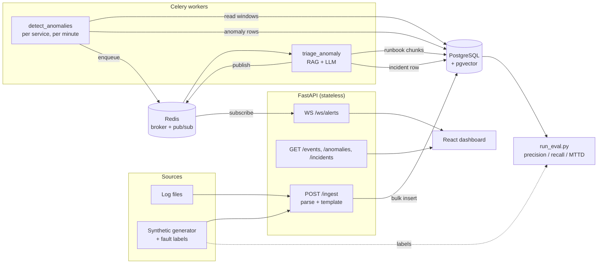
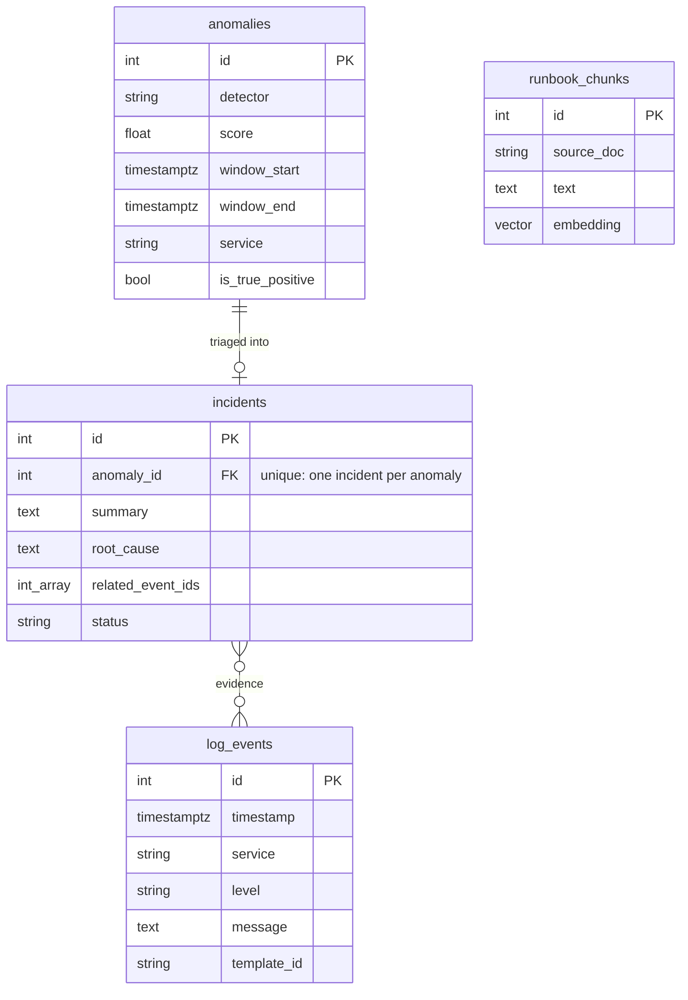

# Sentinel Triage – Design

This document explains *why* Sentinel Triage is built the way it is: the problem,
the architecture, the decisions and their trade-offs, and what changes at scale.
The [README](../README.md) covers how to run it.

---

## 1. The problem

An on-call engineer gets paged at 3 a.m. Five services are emitting thousands of
log lines a minute. They need to answer four questions, fast:

1. **Is something actually wrong?** (not just the usual background errors)
2. **Where?** (which service, since when)
3. **Why?** (which log lines show it, what's the likely root cause)
4. **What do I do?** (which runbook applies)

Threshold alerts ("> 50 errors/min") answer only the first question, and badly:
they are noisy during normal spikes and blind to failures that change the *kind*
of logs rather than the volume (a bad deploy that introduces a new panic message).

**Sentinel Triage turns raw logs into a short, grounded incident report that
answers all four, and measures how well it does it.**

## 2. Requirements

| Type | Requirement | How it's met |
|---|---|---|
| Functional | Ingest logs in ISO, syslog and JSON formats | `app/ingest/parser.py` |
| Functional | Detect anomalous time windows per service | Template features + Isolation Forest (`app/detect/`) |
| Functional | Explain each anomaly with evidence and a runbook | RAG over runbooks + LLM (`app/rag/`, Phase 4) |
| Functional | Push incidents to a live dashboard | WebSocket (`app/api/ws.py`) |
| Quality | **Measurable** detection quality | Labelled synthetic faults → precision, recall, MTTD (`scripts/run_eval.py`) |
| Latency | Mean time to detect < 2 min | 1-minute windows, async workers |
| Cost | LLM is called only for real anomalies, once each | Triage runs per anomaly; `incidents.anomaly_id` is unique |
| Reliability | Ingest never waits on the LLM | Detection/triage run in Celery, not in the request |

## 3. Architecture

### Pipeline stages and their contracts

Each stage has one job and a typed hand-off, so stages can be tested, replaced
or scaled independently.

| Stage | Input → Output | Code |
|---|---|---|
| **Parse** | raw line → `LogEventCreate` (UTC timestamp, canonical level) | `ingest/parser.py` |
| **Template** | message → stable template id (`"GC pause <NUM>"`) | `ingest/templates.py` |
| **Store** | events → `log_events` (batched inserts, committed before 200) | `api/routes_ingest.py` |
| **Featurize** | events → per-service 1-min `WindowFeatures` | `detect/features.py` |
| **Detect** | windows → `AnomalyResult` (higher score = more anomalous) | `detect/iforest.py` |
| **Triage** | anomaly + nearby logs + runbook chunks → `Incident` | `rag/`, `workers/tasks.py` |
| **Serve** | incident → REST + WebSocket push | `api/` |
| **Evaluate** | anomalies + ground-truth labels → metrics | `scripts/run_eval.py` |

## 4. Key decisions

Each is written as *decision → why → what I gave up*.

### 4.1 Turn text into structure before doing ML on it
**Decision:** every message is reduced to a *template* by masking the variable
parts (IPs, numbers, IDs, paths). Detection runs on template counts, not text.

**Why:** "Request completed in 120ms" and "... in 8000ms" are the same event
type. Without templating, every log line is unique and there is nothing to
learn. With it, a bad deploy shows up as *new templates appearing*, which a
volume threshold can't see.

**Lesson from building it:** the first version only masked standalone numbers,
so `350ms`, `usr_12345` and `v1.2.3` slipped through. The 6-hour synthetic log
produced **1,087 "templates" from ~40 real ones**, which made the
`unique_templates` and `new_template_count` features pure noise. Masking any
token that contains a digit brought it to **45**. A regression test now asserts
the template count on generated data stays small.

**Trade-off:** regex masking is simpler and more predictable than a full Drain
parse tree, but it won't merge templates that differ by a word (e.g.
`"task sync"` vs `"task audit"`). Drain3 is the upgrade path.

### 4.2 Windows per service, not one global window
**Decision:** `aggregate_windows(..., service=...)` builds features for each
service separately, and anomalies carry the service.

**Why:** a fault usually hits one service. Pooled across five services, its
error spike is diluted to a fifth, and the detector can't say *where* the
problem is, which is half of what on-call needs.

**Trade-off:** N services means N models (or one model with a service
feature). Fine at tens of services; at hundreds, group services by traffic
profile.

### 4.3 A detector interface and one score convention
**Decision:** every detector implements `fit / score / detect`, and *higher score
always means more anomalous* (Isolation Forest's native score is negated to
match).

**Why:** the project's claim is "a deep model vs. a classical baseline." That
comparison is only fair if both plug into the same pipeline and the same
evaluation, and if their scores can be stored in one `anomalies.score` column
without the reader guessing the sign.

### 4.4 Evaluation is a first-class feature
**Decision:** the generator writes ground-truth fault windows
(`labels.jsonl`) alongside the logs, and `run_eval.py` scores every detector on
**precision**, **recall** and **MTTD** (mean time to detect).

**Why:** "it found some anomalies" isn't a result. A table that says
a table with precision, recall and MTTD for each detector, side by side, is. It also makes every
later change (new feature, new threshold) a measurable experiment.

**Trade-off:** synthetic faults are cleaner than real incidents. The eval is
used for relative comparison between detectors, not as a claim about
production accuracy.

### 4.5 Postgres + pgvector instead of Elasticsearch + a vector DB
**Why:** one datastore for events, anomalies, incidents and embeddings keeps the
system small enough to run with `docker compose up`, and lets an incident link
to its log lines with a normal foreign key/ID array.

**Trade-off:** Postgres isn't a log store at real scale (see §7).

### 4.6 Async work goes through Celery; ingest stays fast
**Why:** an LLM call takes seconds and can fail. Ingest must not wait for it or
fail with it. Detection and triage are Celery tasks with retries; ingest only
parses, templates and inserts.

### 4.7 Real-time push goes through Redis pub/sub
**Why:** the WebSocket connections live in the API process, but incidents are
created in Celery worker processes, and the API itself runs with 2+ workers.
An in-memory set of sockets can't be reached from another process. The worker
publishes to a Redis channel; each API worker subscribes and fans out to its
own clients.

*(Current code has the in-process broadcast; the Redis bridge is part of Phase 5.)*

### 4.8 The LLM is grounded, structured and optional
- **Grounded:** the prompt contains the anomaly's actual log lines (by template,
  with counts) and the top-k runbook chunks, never "guess what went wrong."
- **Structured:** the model returns JSON (`summary`, `root_cause`,
  `evidence_event_ids`, `runbook`, `confidence`), validated with Pydantic.
- **Optional:** if the LLM is down or no key is set, the incident is still
  created with a template-based summary. Detection never depends on the LLM.
- **Bounded cost:** one call per anomaly (unique `anomaly_id`), capped input size.

## 5. Data model

Schema changes go through Alembic (`migrations/versions/`). `create_all` on
startup is only a local-dev convenience; Docker runs `alembic upgrade head`
once before starting the API workers, so they can't race to create tables.

## 6. Reliability and security

| Risk | Mitigation |
|---|---|
| A DB commit fails after the API already said "ingested: 10 000" | Ingest commits *before* returning; the session dependency no longer auto-commits after the response |
| One malformed line fails the whole batch | The parser rejects bad lines individually and they're counted in `errors` |
| `/ingest` used to read arbitrary server files (`/etc/passwd`, `.env`) and serve them back via `/events` | `file_path` must resolve inside `INGEST_ROOT`; traversal → 403 |
| Duplicate incidents if a triage task retries | `incidents.anomaly_id` is unique; task is idempotent |
| LLM outage or rate limit | Celery retries with backoff, then falls back to a non-LLM summary |
| Dead WebSocket clients pile up | Removed in a `finally` block and on failed send |
| Secrets in the repo | `.env` is git-ignored; only `.env.example` is committed |
| No authentication yet | Next step: API key or OAuth on all routes before any public deploy |

## 7. Scaling path

What changes at roughly each order of magnitude:

| Volume | Bottleneck | Change |
|---|---|---|
| ~10k lines/min (today) | none | single Postgres, 2 API workers, 4 Celery workers |
| ~1M lines/min | request-based ingest, row inserts | ship logs through Kafka; COPY-based bulk loads; partition `log_events` by day |
| ~100M lines/min | Postgres as log store | move raw logs to ClickHouse / object storage; keep only templates, windows, anomalies and incidents in Postgres |
| many services | one model per service | streaming feature computation (Flink / Kafka Streams), models grouped by service profile |

## 8. Build plan

The order is deliberate: a thin **end-to-end slice with numbers** first, polish later.

| Phase | Deliverable | Why this order |
|---|---|---|
| 0–1 ✅ | Skeleton, parser, storage, generator | Foundation |
| 2 | Detection task writes `anomalies` per service | First real output |
| 3 | `run_eval.py` produces precision / recall / MTTD | **Proves it works** before adding complexity |
| 4 | RAG + LLM triage | The "wow" feature, now measurable |
| 5 | Dashboard + Redis-backed WebSocket | Makes it demoable |
| 6 | LSTM autoencoder vs. Isolation Forest table | The ML comparison story |
| 7 | Hosted demo + screenshots + metrics in README | What a reviewer sees first |
